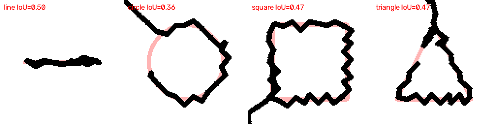
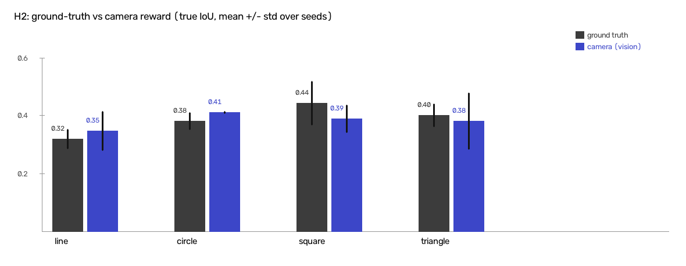
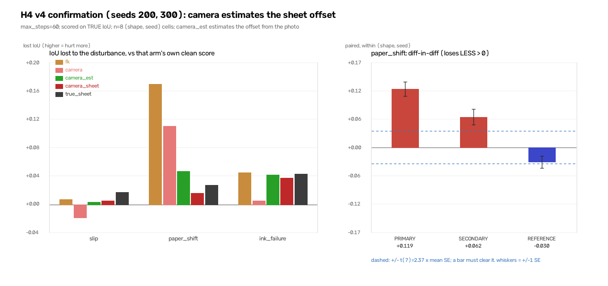

# RoboSketch-RL

**A simulated robot arm that learns to draw with reinforcement learning, and a measurement of what
it loses when it learns from its camera instead of from the exact canvas.**

*Viral Kanani · individual research project · simulation (PyBullet, KUKA arm) · 2026*


*Black: the ink a trained PPO agent put down. Pink: the target shape. IoU = overlap with the target.*

---

## The question

Many RL drawing agents are rewarded from a **privileged signal**: the exact virtual canvas. A real
robot does not have one. It only has a camera, which blurs, misses faint ink and can be fooled. So:

1. **How much accuracy is lost** when the reward comes from a camera image instead of the truth?
2. **Does seeing the paper help when things go wrong** (paper slides, pen slips, ink runs out),
   compared with a robot that draws "blind" from its joint angles?

This is a *measurement* project. RL for robot drawing, vision-based rewards and closed-loop visual
feedback all exist already (see [`research_papers/`](research_papers/README.md) for the 34 papers
reviewed). What is measured here is the cost and benefit of the camera, under controlled conditions,
with paired multi-seed statistics.

## Main results (simulation only)

| Question | Result |
|---|---|
| **H2** Camera reward vs exact-canvas reward | Equivalent within ±0.05 IoU (TOST, margin fixed before the run): truth 0.388 vs camera 0.384, difference +0.004, t = +0.27, 12 paired runs |
| **H3** Does the agent cheat the camera reward? | No exploitation found |
| Camera realism (domain randomisation) | Not the bottleneck: a camera that loses more than half the ink costs 0.014 IoU |
| **H4** Paper shifts mid-drawing: camera vs joint-angle agent | The camera agent that **estimates the sheet offset from its photo** loses 0.046 IoU, the joint-angle agent 0.165. Difference +0.119, 8/8 pairs, t = +8.32, replicated on fresh seeds (pre-registered). No clean head start (+0.006) |
| H4, pen slip and ink failure | **No detectable advantage** for the camera |
| **H5** Does open-loop error grow? | Yes; a closed-loop controller stays flat (n = 80 pairs). Shows feedback matters, not specifically a camera |
| Does it draw or memorise? | Partly memorises: loses IoU on resized/rotated versions of its training shape |
| Line-first curriculum | Hurts: 0.246 vs 0.418, t = −2.99 |
| PPO vs SAC (same task, 200k steps) | SAC far behind at this budget: 0.051 vs 0.292 train-family IoU, 0/8 pairs, t = −9.71. One untuned SAC setting, so this does not say PPO is better in general |




Honest limits: everything is in simulation; one arm, one camera model, simple shapes; absolute IoU is
modest (~0.4). Every number above is traceable to a script's printed output and to a dated entry in
[`docs/RESEARCH_LOG.md`](docs/RESEARCH_LOG.md), including the negative results and corrections.

## How it works

```
target shape ─► PPO agent (CNN policy) ─► move the pen (dx, dy)
                                  │  inverse kinematics drives the KUKA arm
                                  ▼
                           pen inks the paper (PyBullet)
                                  │
                                  ▼
          reward = IoU with the target, read EITHER from the exact canvas (truth)
                   OR from a simulated camera image (vision)
                                  │
                                  └──────► back to the agent
```

All arms are **scored on the true canvas**, whatever reward they learned from. Comparisons are
paired within (shape, seed), with seeds spaced far apart (0, 100, 200, 300).

## Repository layout

| Path | What it is |
|---|---|
| `sim/` | Simulator basics: arm, IK, pen, camera |
| `rl/draw_env.py` | The Gymnasium drawing environment |
| `rl/perception.py`, `rl/disturb.py` | Simulated camera; disturbances (slip, paper shift, ink failure) |
| `rl/*_experiment.py` | One script per experiment, each resumable, each with `--aggregate` |
| `results/*.jsonl` | Raw results of every run (append-only) |
| `output/` | Figures |
| `docs/RESEARCH_LOG.md` | Full lab notebook: every decision, result and correction |
| `docs/paper/` | Paper draft (LaTeX) and a lint script that checks every number has a source |
| `docs/README_full_status.md` | The older, much longer status table |
| `research_papers/` | Literature notes (the PDFs themselves are not redistributed) |

Not in the repo: trained models (`models/`, ~64 MB) and videos. Re-train with the scripts below.

## Setup and quick start

PyBullet has no Windows pip wheel, so use conda:

```bash
conda env create -f environment.yml
conda activate robosketch

python rl/train.py --shape circle --timesteps 200000 --reward-mode vision   # train one agent
python rl/watch.py --shape circle --reward-mode vision                      # watch it draw
python rl/h4_confirm.py --aggregate                                         # re-print the H4 replication table
```

Stack: Python 3.10, PyBullet, Gymnasium, Stable-Baselines3 (PyTorch), OpenCV.

## Status and next steps

- ✅ Simulation experiments (H2–H6 and extensions) and a paper draft.
- ⏳ Real hardware: a low-cost arm + webcam, to test whether the simulation results hold.

## How this was built

Designed and run by Viral Kanani with AI coding assistants (Claude Code) used for implementation,
analysis and writing.
